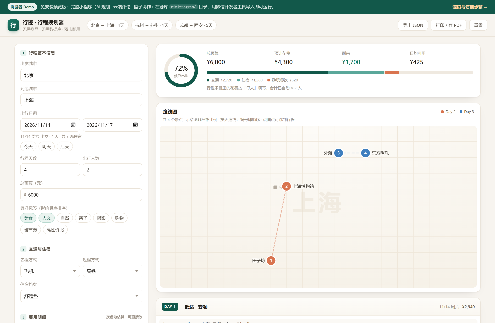
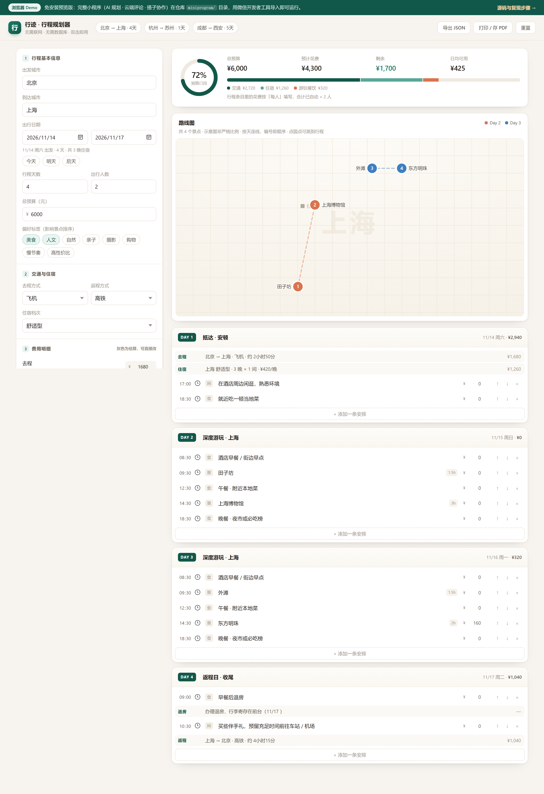
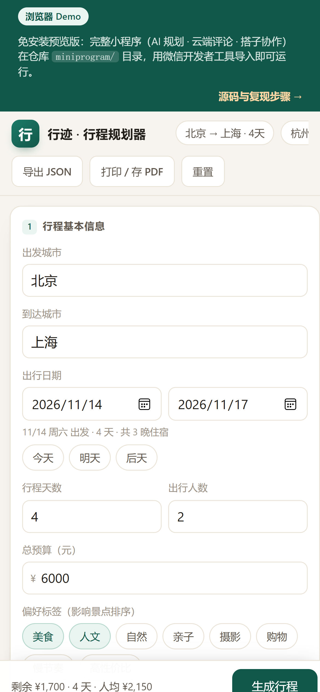

# 行迹 · 旅行规划微信小程序

> 背上行馕就出发！
>
> 「行迹」是一款面向国内 60 座城市的旅行规划小程序：输入出发地、目的地、天数与预算，即可一键生成按天分色的行程路线图，支持 AI / 智能双模式规划、景点评论讨论、云端「想去」共享，以及 6 位搭子码邀请好友一起改行程。

<div align="center">



</div>

## ✨ 功能亮点

| 功能 | 说明 |
|---|---|
| 🧠 AI / 智能双模式 | 接入大模型流式生成行程，无云服务时自动回退本地智能排程，演示永不中断 |
| 🗺️ 行程路线图 | 按天分色的 SVG 路线图 + canvas 海报长图，一键保存分享 |
| 📍 60 城 · 219 景点 | 内置城市坐标与真实景点库（门票 / 开放时间 / 建议时长 / 经纬度 / 插画配图） |
| 💰 费用精算 | 交通往返 + 住宿（按间夜）+ 游玩餐饮（按人头）自动汇总，预算余额实时可见 |
| 💬 评论与点赞 | 景点页快捷标签开聊（避雷 / 必吃 / 拍照机位 / 路线建议），最新 / 最热排序 |
| ❤️ 「N 人想去」 | 云端收藏共享，看看哪些景点大家都在种草 |
| 🤝 搭子协作 | 生成 6 位搭子码，好友输入即可加入同一份行程，改动互相同步 |
| 📴 离线可用 | 未配置云服务时全部数据落本机，clone 即演示 |

## 🖼️ 界面一览

| 行程总览 | 路线图 | 移动端 |
|---|---|---|
|  |  |  |

## 🚀 快速开始

### 方式一：浏览器 Demo（免安装，30 秒上手）

直接克隆后双击打开，或访问在线版（由 GitHub Pages 自动部署）：

```
https://mei117-a.github.io/xingji-travel-planner/
```

```bash
git clone https://github.com/Mei117-a/xingji-travel-planner.git
# 用浏览器打开 demo/index.html 即可
```

> 这是与小程序同一套数据口径的浏览器预览版（纯前端、无需任何依赖），
> 覆盖智能规划、路线图、费用汇总核心链路；AI 规划与多人协作请用方式二。

### 方式二：微信开发者工具（完整功能）

1. **克隆仓库**

   ```bash
   git clone https://github.com/Mei117-a/xingji-travel-planner.git
   cd xingji-travel-planner
   ```

2. **导入项目**：微信开发者工具 → 导入 → 选择仓库根目录（会自动读取 `project.config.json`）

3. **（可选）接入云服务**：不配置也能跑 —— 小程序检测到无云服务时自动进入
   **本机演示模式**（评论、收藏、搭子码存本机，AI 规划回退智能排程）。
   需要真实云端能力时执行：

   ```bash
   npm install --production          # 安装 @tencent-ai/workbuddy-cloud-sdk
   # 开发者工具：工具 → 构建 npm
   ```

   然后在 `miniprogram/utils/cloud.js` 填入自己的 endpoint / publishableKey。

4. **填 AppID**：`project.config.json` 里把 `touristappid` 换成自己的小程序 AppID
   （没有的话用测试号也能预览）。

5. 点「预览」扫码真机体验，或直接在模拟器里运行。

### 验证核心逻辑（无需开发者工具）

```bash
node scripts/verify.js
```

不依赖微信与云服务，直接在 Node 里跑规划引擎与本机数据层，21 项断言全过：

```
[1/4] 数据资产    ✓ 60 座城市 / 219 条景点 / 20 张配图
[2/4] 规划引擎    ✓ 单日往返仍保留返程 / 7 天行程 / 空景点城市降级
[3/4] 费用口径    ✓ 游玩费随人数翻倍 / 住宿按间夜 / 总额分项一致
[4/4] 本机数据层  ✓ 评论 / 收藏去重 / 搭子码存取
结果：21 项全部通过 ✅
```

## ☁️ 接入自己的云服务

云能力基于 [WorkBuddy 云服务](https://www.workbuddy.cn)（免密钥 LLM + 托管 PostgreSQL），
需要三张表（字段与 RLS 策略见 `miniprogram/utils/store.js` 注释）：

| 表 | 字段 | 权限 |
|---|---|---|
| `comments` | id, spot_key, spot_name, city, nickname, content, created_at, likes | 公开读写，仅 likes 可更新 |
| `spot_favs` | id, spot_key, spot_name, city, device_id, created_at | 公开读写删 |
| `shared_trips` | code(PK), title, plan(JSONB), demand(JSONB), updated_by, updated_at | 公开读写改 |

开通后在 `miniprogram/utils/cloud.js` 替换 `publicConfig` 即可。
仓库里的 publishableKey 是端侧公开配置（会打包进小程序，非私密凭证），
介意共用配额可换成自己的。

## 📁 项目结构

```
xingji-travel-planner/
├── miniprogram/               # 小程序本体（微信开发者工具导入这个根目录）
│   ├── app.json               # 4 个 tabBar：规划 / 行程 / 景点 / 关于
│   ├── pages/
│   │   ├── plan/              # 需求录入 + AI/智能生成（流式渲染）
│   │   ├── trip/              # 时间线编辑、地图路线、海报、搭子协作
│   │   ├── spots/             # 景点库浏览（按城市 / 标签 / 收藏）
│   │   ├── detail/            # 景点详情：图片、评论、点赞、想去
│   │   └── about/             # 团队与说明
│   ├── utils/
│   │   ├── data.js            # 60 城坐标 + 219 景点 + 纯函数规划引擎
│   │   ├── store.js           # 统一数据层：云端优先，失败自动落本机
│   │   ├── localdb.js         # 本机降级实现（wx.storage）
│   │   ├── cloud.js           # 云服务客户端（可选）
│   │   ├── ai.js              # LLM 流式行程生成 + JSON 解析回退
│   │   └── social.js          # 想去计数 / 点赞 / 馕队主题昵称
│   └── assets/                # 6 色地图标记 + 20 张景点插画
├── demo/                      # 浏览器免安装预览版（GitHub Pages 站点）
├── scripts/
│   ├── verify.js              # 离线自检（node scripts/verify.js）
│   └── shots.js               # 文档截图生成（开发期工具）
└── docs/screenshots/          # 界面截图
```

## 🧱 技术实现要点

- **纯函数规划引擎**：`buildPlan(demand)` 负责地理就近排程、往返交通、住宿间夜，
  与 UI 完全解耦，可在 Node 里单测（`scripts/verify.js` 即证明）。
- **统一数据层**：页面只认 `store.js`，云端请求失败一次即自动降级本机，
  降级后 UI 显示「本机演示模式」提示，功能链路不断。
- **AI 流式生成**：LLM 输出结构化 JSON，解析失败或无可用模型时回退本地排程，
  并在生成过程中实时流式渲染。
- **地图与海报**：按天分色的路线图用原生 `map` 组件（marker/polyline），
  canvas 2d 绘制行程海报长图，支持保存与转发分享。

## 👥 团队

**新疆馕队**（未来杯参赛作品）

| 角色 | 成员 |
|---|---|
| 项目负责人 | 马玉梅 |
| 成员 | 王倩 · 张一鸣 · 尹寅忠 · 王谷雨 |
| 指导老师 | 韩子伟 |

## 📄 License

[MIT](LICENSE) © 2026 新疆馕队
